<div align="center">

**English** · [繁體中文](#-繁體中文)

# 🗺️ EngramQuest

**You take notes you never open again. EngramQuest turns your Obsidian vault from a note graveyard into memory you can actually use.**

</div>

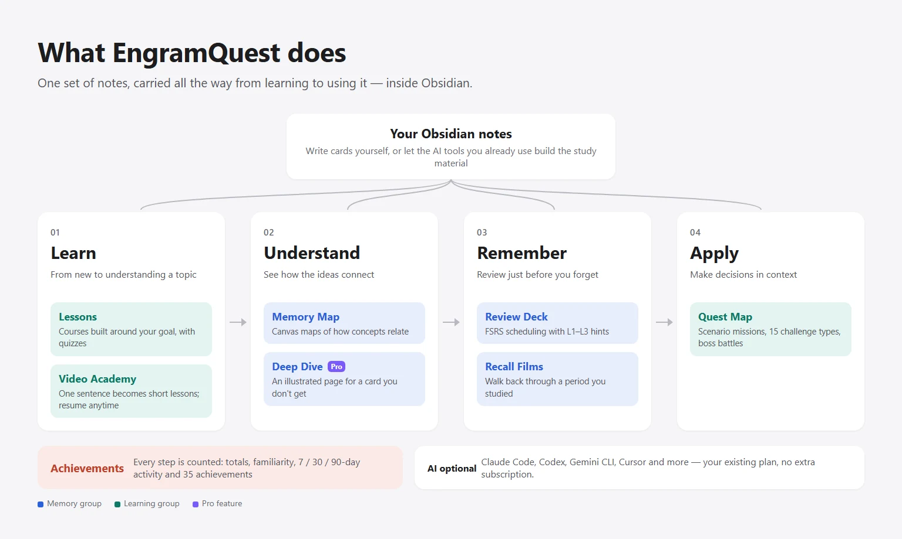

## What is EngramQuest?

EngramQuest is an AI-powered learning layer on top of your Obsidian notes. Most notes get written once and never touched again — EngramQuest closes that loop and turns them into knowledge you actually keep.

You can write flashcards by hand, or just point your AI tool at a note and let it build the study material for you — no copy-pasting, no rebuilding cards from scratch. From the same notes, EngramQuest can spin up an **interactive course** that teaches the topic, a game-like **quest** that drills you, a **memory map** that shows how the ideas connect, or a **review deck** that uses FSRS spaced repetition to make it stick.

The AI runs through tools you already have — **Claude Desktop, Claude Code, Codex, Antigravity, Gemini CLI, Cursor**, and more. They do the generating, so there's **no extra subscription and no per-token API fees** — your existing plan is enough, and AI is fully optional.

The point isn't to collect more notes. It's to **learn them, practice them, and remember them** — all inside Obsidian.

---

## 💡 Why EngramQuest?

Anki solves *when* to review. EngramQuest solves *how* to actually remember — and what to do **before** the flashcard stage: learning it, practicing it, and connecting it, not just drilling cards.

Every module works on its own, or chains into the next. **AI is optional** — and it runs on the AI tools you already use (Claude Code, Codex, Antigravity, Gemini CLI, Cursor), not another subscription.

---

## 🧭 Where to open it

Once the plugin is installed, click the **EngramQuest icon in the left ribbon** — that's how you open it. (A few people miss this at first, so here's exactly where to look.)

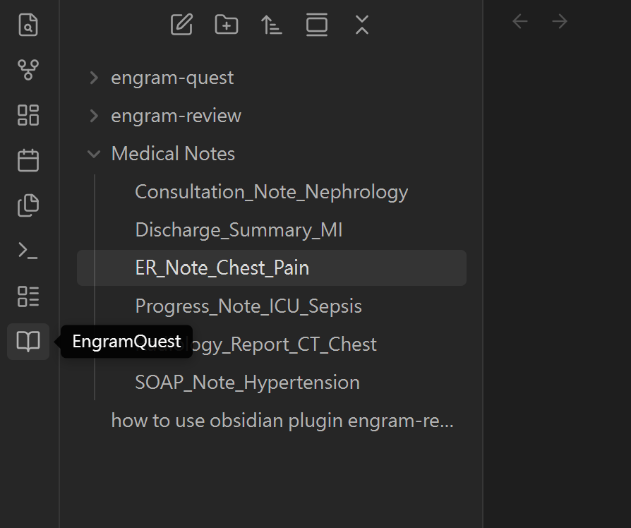

### Inside the Hub

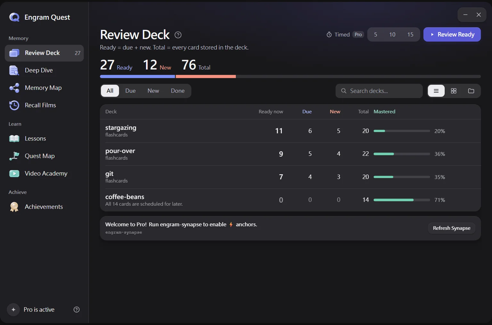

The sidebar groups every page by what you are doing:

- **Memory** — Review Deck, Deep Dive (Pro), Memory Map, Recall Films
- **Learn** — Lessons, Quest Map, Video Academy
- **Achieve** — Achievements

The library pages (Review Deck, Deep Dive, Memory Map, Lessons, Quest Map, Video Academy) open with their key numbers and a progress bar, then the same toolbar: search, filters, sort, and list / grid / folder views. The **?** at the bottom of the sidebar, next to Pro, opens the full guide; the **?** beside a page title reopens that page's short guide, which also appears the first time you open the page. On a phone the Hub becomes three tabs at the bottom (Memory, Learn, Achieve), and the **?** sits in the top-right corner.

---

## ⚡ Quick Start (AI Path)

<div align="center">

<a href="https://youtu.be/X9RhfC-l8d4"></a>

▶️ **[Watch the 1-minute Quick Start](https://youtu.be/X9RhfC-l8d4)**

</div>

1. **Install the plugin** — [open in Obsidian](obsidian://show-plugin?id=engram-quest), search **EngramQuest** in Community Plugins, or grab it from [GitHub Releases](https://github.com/bahfahh/engram-quest/releases).
2. **Install the Skills** — go to `Settings → EngramQuest → AI Skills` and click **Install** for your tool (Claude Code, Codex / Antigravity, Gemini CLI, or Cursor). Installed skills stay up to date automatically when the plugin updates (toggle in Settings); if outdated skills are ever detected, the Hub shows a reminder banner with a one-click **Update skills** button.
   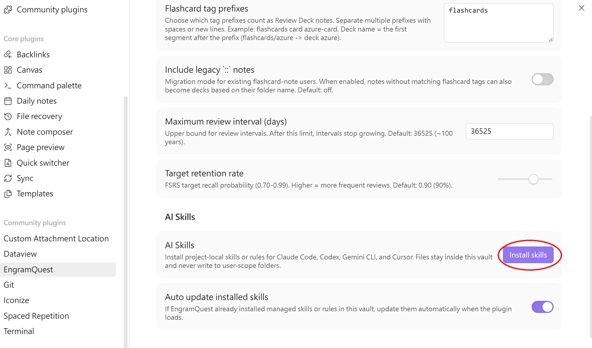
3. **Ask your AI** — *"Turn `Note.md` into a quest-map medium"* or *"Build a review deck from notes tagged math."*
4. **Open the Hub** — click the EngramQuest ribbon icon, pick the page in the sidebar, and start learning.

> 💬 **Using Claude Desktop?** No terminal required — paste one Setup Prompt and Claude connects to your vault automatically, loads the skills, and remembers the rules. Open the in-plugin guide (the **?** at the bottom of the Hub sidebar), expand **Getting started**, and press **Copy setup prompt** under *No terminal? Use Claude Desktop*. Claude Desktop also has built-in web search and can generate SVG diagrams alongside your content.

> **Not a SaaS.** Skills are the execution logic that run inside the AI tool you already have. No extra account, no subscription, and AI is fully optional.

---

## ✨ Features

### 🃏 Review Deck — Remember More, Study Less

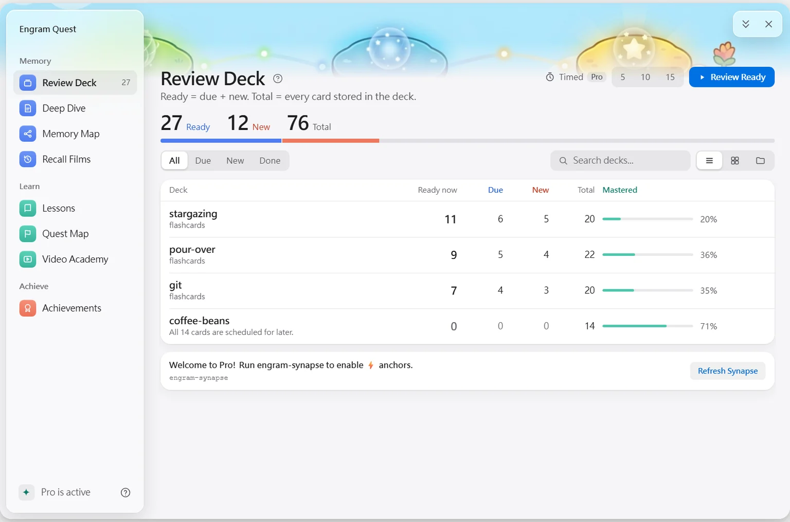

A three-stage recall system that builds real memory, not just familiarity:

| Stage | What it does | Anywhere else? |
|---|---|---|
| **L1 Active Recall** | Question only — forces your brain to search first, before any hint | ✅ most flashcards |
| **L2 Contextual Anchor** ⭐ | AI searches *your* vault and rebuilds the moment you first learned this topic | ❌ **only here** |
| **L3 Narrowing Hint** | A keyword direction as a last resort — never the full answer | rare |

- **FSRS-5 scheduling** — intervals adapt to your actual recall, not preset multipliers
- **AI cards stay separate** — generated cards live in `engram-review/`, AI never touches your source notes
- **5 mixable card formats** — paste long AI answers, multi-line Q&A, cloze, one-liners, all in one note
- **Edit writes back** — fix a card mid-review and the change saves to your source note
- **Auto-detection** — any note tagged `#flashcards/topic` is picked up automatically

**📺 Watch:** <a href="https://youtu.be/XC0NsPVfcwE"></a> <a href="https://youtu.be/pMf5mfCswBo"></a>

▶️ [Build your own Review Deck](https://youtu.be/XC0NsPVfcwE) · ▶️ [Create a deck by pasting an AI answer](https://youtu.be/pMf5mfCswBo)

### 🗺️ Quest Map — Practice Missions

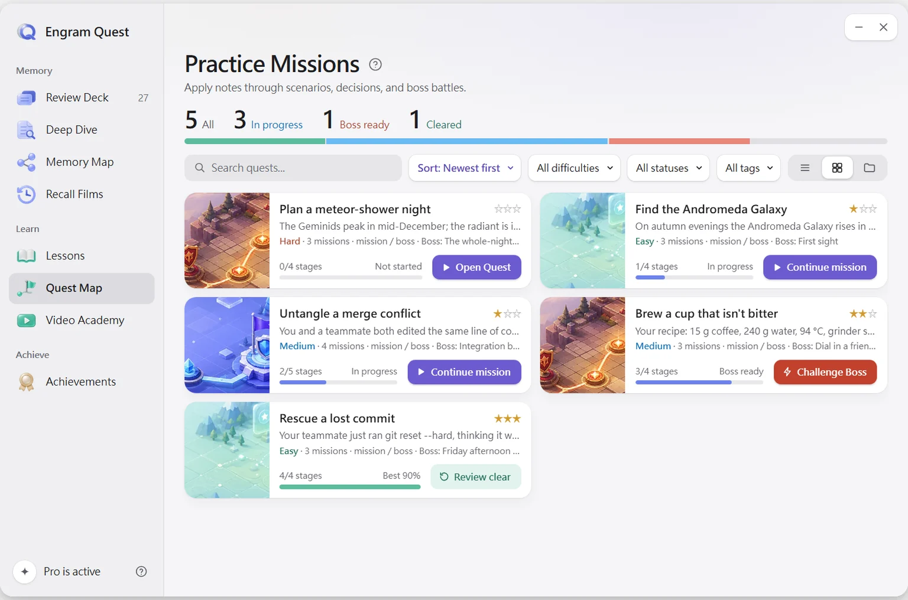

Turns a note, a topic or a Lesson Academy course into a practice map where you find out whether you can **use** what you know. Each mission puts you in a situation you have not seen, with the real material in front of you, and asks you to do what someone with the skill would do — then scores it.

- **One package per quest** — a map and one self-contained interactive page per mission, saved in `engram-quest/quests/` and opened from the Quest Map page
- **Difficulty tiers** — Easy / Medium / Hard, ask your AI for the level you need
- **Boss Battle** — a final applied case that tests judgment, sequencing, tradeoffs, or diagnosis
- **Progress is safe** — scores and completion live in `engram-quest/state/`, apart from the quest, so AI can update a quest without wiping your progress
- Older quests written as a `quest-map` block inside a note still open

### 🎓 Lesson Academy — AI-Built Courses

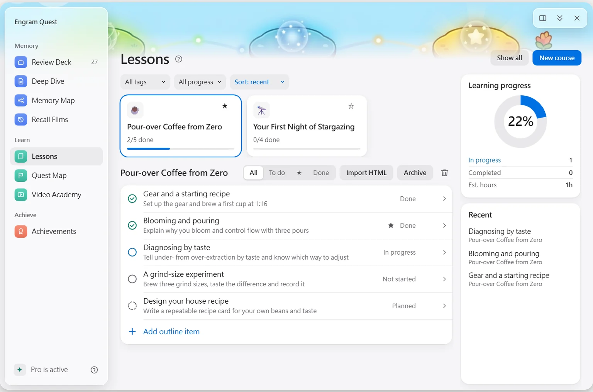

Tell the AI what you want to learn — it builds a course of interactive HTML lessons you study right inside Obsidian.

- **Goal-first** — the skill asks *why* you're learning and your current level, so a .NET dev learning React gets a different course than a designer would
- **Outline-first** — it shows the course plan for your approval before generating (changing the plan is cheap; regenerating lessons is not)
- **Vault-aware** — point it at your existing notes and the course connects to what you already know
- **Web-verified** — for fast-moving tech topics it checks the web and cites sources, instead of guessing
- **Concept-map steps** — courses can mix in native Obsidian Canvas maps (learning maps, comparisons, classifications) that open in a real Canvas tab, fully draggable and annotatable
- **Each lesson ends with a quiz** for an immediate feedback loop — then convert the whole course into Review Deck cards or a Quest Map

**📺 Watch:** <a href="https://youtu.be/G8HxBl9Hf9o"></a>

▶️ [Create a course with Claude Code](https://youtu.be/G8HxBl9Hf9o)

### 🎬 Video Academy — One Sentence, Short Video Lessons

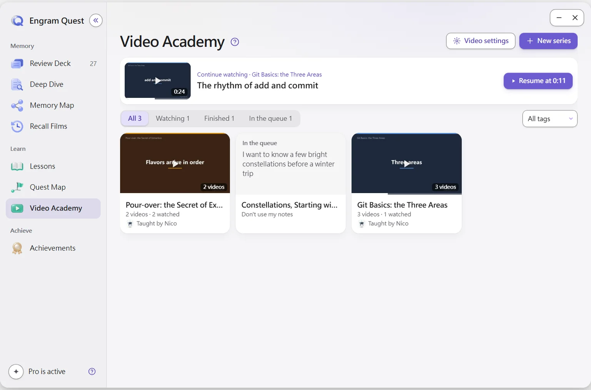

Say what you want to learn or review — "my coding workflow", "SEO" — and the AI turns it into short video lessons, each sized to what it teaches.

- **Just say the goal** — "build a website", "learn functions"; add detail if you like. The AI decides which of your notes to use (drop notes in to narrow it down, or choose *Don't use my notes*), whether it's a lesson or a review, and how many videos to make
- **Shelf → player** — browse series as cards (filter by watching / not started / finished / to be generated, by tags the AI assigns such as "Software", and search once you have many), open one to watch with a playlist; your position is saved so you resume where you stopped
- **Choose your teacher** — each teacher teaches in a different way, and you can see and hear them first. Nico is free; the other teachers and giving one series its own teacher need Pro. Series still waiting to be made can be edited
- **Set it once** — teacher, quality (*High quality* is 1080p, *Space saver* is 720p), narration language, voice engine, subtitles and review cards live in *Video settings*. Every video is shot in the Engram studio, and the AI picks a light or dark set to suit the content
- Videos live in `engram-quest/videos/` inside your vault. On desktop, the folder button next to *Mark as watched* shows the video file in your system file explorer. To watch on your phone, make sure your sync tool also syncs the mp4 files there — don't exclude them (with git, every video stays in the history; that is your trade-off to make)

> Videos are made with **Claude Code**: install the **Animated Course** skill in `Settings → EngramQuest → AI Skills`, add a series with **New series**, then ask Claude Code to make it.

### 🧠 Memory Map — See the Big Picture

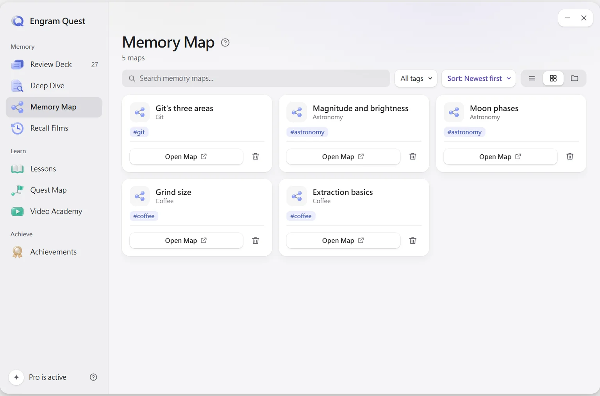

Visualizes abstract concepts using Obsidian Canvas.

- AI generates a visual knowledge graph using memory science — novelty, association to your existing notes, chunking, and analogy
- Any file named `{note-name}-memory.canvas` is auto-detected in Hub → Memory Map
- During review, the Memory Map button finds and opens the matching canvas automatically

### 🎞️ Recall Films — Walk Back Through What You Studied

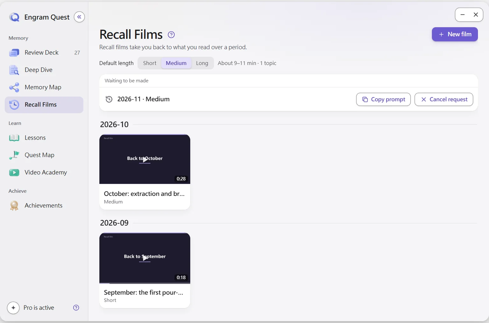

A recall film takes you back to what you read over a month, or a range of months, so the ideas come back in the context you met them. Every topic first gets a **recall pack** — a one-line overview plus retrieval questions that go into your Review Deck — and only the topics worth it get a film.

- **Watch for free** — films are grouped by period, newest first; open one to play it
- **Make a new film (Pro)** — click **+ New film**, pick the period and a length (short, medium or long; set a default once), and the request waits in *Waiting to be made*. Copy its prompt into Claude Code, which makes the film with the **Episodic Review** skill; you can cancel a request any time
- Films are stored in `engram-quest/videos/episodic-recall/`

### 🏆 Achievements

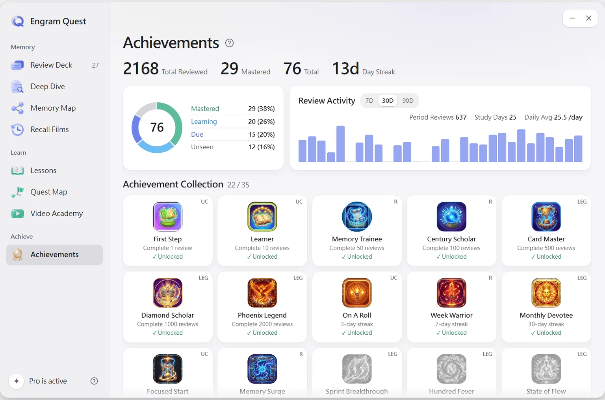

Track your learning milestones with 3D-rendered icons and rarity tiers — from reviews and streaks to mastered cards, Lesson Academy completion, and Quest Map progress. The page shows your totals, how familiar your cards are, and your activity over the last 7, 30 or 90 days. Click any achievement to see its details and progress.

### 📖 Deep Dive — plain-language rescue for hard cards (Pro)

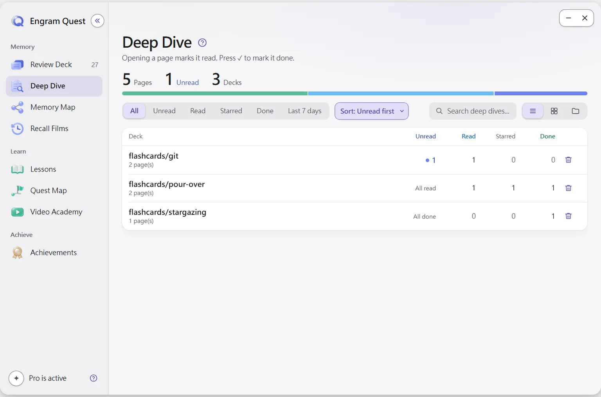

When a flashcard is too hard to understand, hit **Queue deep dive** during review. The AI diagnoses why the card failed you (too hard? too terse? missing context?) and generates a self-contained, illustrated deep-dive page — problem first, then the big-picture map, a memory anchor metaphor, a layered walkthrough, and common confusions, ending back at your original card. Deep dives carry **no schedule of their own**: the original card keeps reviewing, and if it keeps failing, the page is automatically rewritten from a shallower entry point. You can also ask directly — *"Make a deep dive about the data flywheel."* The same skill makes **Insight** pages: point it at a topic, a course or a folder of notes and it shows how the pieces fit together and what follows from them. The Deep Dive page appears in the Memory group once Pro is active. Its progress bar splits pages into **completed, read and unread**; opening a page marks it read, and only your own ✓ marks it completed. Star the ones worth revisiting.

---

## 🚀 Decided to try it? Your first 60 seconds

1. **Install the plugin** — search **EngramQuest** in Community Plugins (or [open it in Obsidian](obsidian://show-plugin?id=engram-quest)).
2. **Open the Hub** — click the EngramQuest icon in the left ribbon.
3. **Pick a path:**
   - **No AI?** Tag any note `#flashcards/topic`, write a `Q:/A:` card, and it appears in your Review Deck instantly. → [Write cards yourself](#-write-cards-yourself-no-ai-required)
   - **Have an AI tool?** Install the Skills once (`Settings → EngramQuest → AI Skills`), then just say *"Build a review deck from my math notes."* → [The AI path](#-quick-start-ai-path)

---

## ✍️ Write Cards Yourself (No AI Required)

Add a `#flashcards/topic` tag and pick a format. All five are freely mixable in one note:

| Format | Best for | Syntax |
|---|---|---|
| 🟢 `Q:/A:` Q&A ⭐ | **Recommended daily format.** Multi-line answers, images, tables, code | `Q: question` → `A:` — two blank lines end the card |
| 🔵 `---` fenced Q&A | Existing notes where blank lines appear inside answers | Wrap `Q:/A:` with `---` lines |
| 🟡 `%%card%%` long answer | Pasted AI output that may contain its own `---` separators | Wrap one card between two `%%card%%` lines |
| 🧩 `{{c1::}}` Cloze | Fill-in-the-blank, Anki-compatible | `{{c1::answer}}` or `{{c1::answer::hint}}` |
| ⚪ `::` one-liner | Quick single-line Q&A only | `question :: answer` |

<details>
<summary>See card format examples</summary>

```
#flashcards/math

Q: What is a derivative?
A: The instantaneous rate of change of a function at a point.
   Formally: lim(h→0) [f(x+h) − f(x)] / h

---
Q: What is Stripe's core model?
A: Stripe is essentially a Saga system.
   It handles the payment_intent state machine, retry / failure handling,
   and fund consistency. You only receive the result.
---

%%card%%
Q: How should I explain agentic testing?
A:
Agentic testing checks whether an AI system can complete a task reliably.
---
This separator stays inside the answer.
%%card%%

{{c1::Calculus}} is built on limits, derivatives, and integrals.

Pythagorean theorem :: a² + b² = c²
```

> **Tip:** Press `Ctrl+/` (or `Cmd+/`) on an empty line — Obsidian inserts `%% %%` with the cursor inside. Type `card` and you get `%%card%%` instantly.

</details>

---

## 🔬 Why It Works

EngramQuest is built on four pillars of cognitive science:

| Principle | Feature |
|---|---|
| Spaced Repetition | FSRS schedules reviews at the moment of near-forgetting |
| Retrieval Practice | L1 forces active recall before any hint is shown |
| Contextual Anchoring | L2 anchors each card to knowledge already in your vault |
| Elaborative Encoding | Memory Map builds visual structure for abstract concepts |

---

## ❓ FAQ

**Q: Do I have to use AI?**
No — many users don't. Write cards with `Q:/A:`, `::`, or `{{c1::}}`, add a `#flashcards/topic` tag, and the plugin picks them up automatically.

**Q: Where is my progress stored?**
Scheduling data lives in `engram-review/sr/` inside your vault as JSON. AI-generated cards are in `engram-review/ai-cards/`. Neither touches your source notes.

**Q: Does EngramQuest support Anki?**
Partially. The `::` and `{{c1::}}` formats are Anki-compatible — pair them with the **Obsidian_to_Anki** community plugin. The `Q:/A:` format is EngramQuest-native (rich multi-line answers) and does not sync to Anki.

**Q: How do I make AI always follow a pattern when building decks?**
Mark key answers with `==highlight==` or `**bold**`, then add a rule to your AI config file (`CLAUDE.md`, `GEMINI.md`, or `AGENTS.md`):
> `IMPORTANT: When building a Review Deck, every highlighted ==text== must become a review card.`

---

## Pro: four ways to learn

**US$11.99 one-time purchase. Future Pro feature updates included.** All existing free features stay available without upgrading. Applicable taxes appear at checkout.

| Pro feature | What it adds | Availability |
| --- | --- | --- |
| Memory anchors · Synapse | During review, a small map connects the card to what you have learned: mastered cards, notes, deep dives, lessons and videos, each with the reason it is related | Available; the skill prepares the links |
| Deep dive | Queue difficult cards, generate illustrated explanations with the skill, and read them in the Hub | Available |
| Time-boxed review | Choose 5 / 10 / 15 minutes to review priority cards | Available |
| More teachers and recall films | Teachers who each teach in their own way, a teacher per series, and recall films made from your notes | Available; videos are made with Claude Code |

Video Academy management, Nico, and watching any video, including recall films you already have, remain free. Open **Pro** at the bottom of the Hub sidebar (on a phone, the Pro row on the Memory page) or **Settings → EngramQuest → Explore Pro** for the illustrated overview. It opens only when selected; no automatic upgrade popup. Separate light and dark illustrations follow the Obsidian theme. Copy your key from Polar and activate it in Settings, then reopen the Hub.


**Disclosures.** Pro is an optional one-time payment (US$11.99, through Polar). The plugin uses the network for two things: license validation with Polar (api.polar.sh; sandbox-api.polar.sh for local tests), which sends the key and organization/benefit identifiers and never note content, and downloading the video assets from this project's GitHub Releases when you install the video skills. Hosted checkout and the customer portal are operated by Polar. The key and a bounded success cache stay in plugin data.json; a successful validation allows up to fourteen days offline, and plugin updates trigger an online recheck. Removing the local license preserves learning data. Installing skills writes files to your vault's `.claude/skills/` (and the matching folders for other AI tools). This development build uses sandbox and accepts only test keys.

---

## ☕ Support

If EngramQuest is useful to you, consider supporting its development:

[](https://ko-fi.com/wen_aidev)

---

<div align="center">

# 🇹🇼 繁體中文

[English ↑](#-engramquest)

**你的筆記寫完就再也沒打開過。EngramQuest 把你的 Obsidian vault 從筆記墳場，變成你真的用得到的記憶。**

</div>

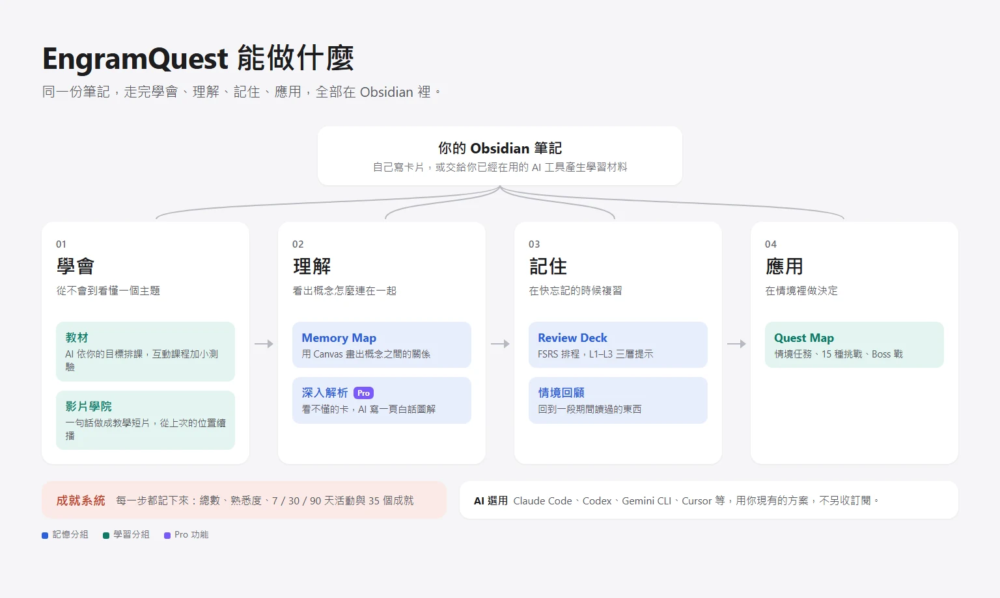

## EngramQuest 是什麼？

EngramQuest 是架在你 Obsidian 筆記之上的一層 AI 學習系統。大多數筆記都是寫完就再也沒碰 — EngramQuest 把這個迴圈補起來，讓筆記變成你真正留得住的知識。

你可以自己手寫複習卡，也可以直接把一篇筆記丟給你的 AI 工具，讓它幫你把學習材料生出來 — 不用複製貼上、不用一張張重做卡片。同一篇筆記，EngramQuest 能變成一門教你這個主題的**互動教材**、一張操練你的**闖關地圖**、一張看出概念怎麼連結的**記憶地圖**，或一套用 FSRS 間隔複習、讓你真的記住的**複習卡組**。

AI 跑在你本來就在用的工具上 — **Claude Desktop、Claude Code、Codex app、Antigravity、Gemini CLI、Cursor** 等等。生成都由它們完成，所以**不用另外訂閱、也不用額外付 API token 費用** — 你現有的方案就夠了，而且 AI 完全可選。

重點不是再囤更多筆記，而是**真的學會它、練熟它、記住它** — 全部在 Obsidian 裡。

---

## 💡 為什麼選 EngramQuest？

Anki 解決「何時複習」。EngramQuest 解決「如何真正記住」 — 以及閃卡階段**之前**該做什麼：學會它、練熟它、把它連起來，而不只是反覆刷卡。

每個模組都能單獨使用，也能串接到下一個。**AI 完全可選** — 而且它跑在你已經在用的 AI 工具上（Claude Code、Codex、Antigravity、Gemini CLI、Cursor），不是另一個訂閱服務。

---

## 🧭 從哪裡打開

安裝插件完成後，點左側 ribbon 的 **EngramQuest 圖示**就能打開。（不少人一開始會找不到入口，這裡標清楚位置。）


### Hub 裡有什麼

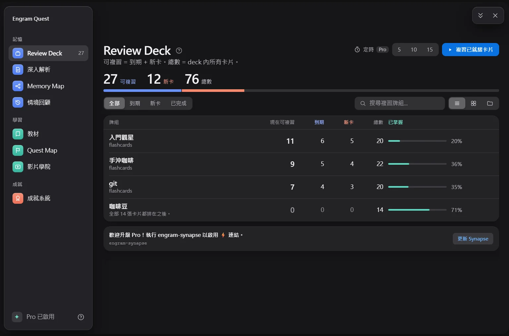

側欄依你在做的事分組：

- **記憶** — Review Deck、深入解析（Pro）、Memory Map、情境回顧
- **學習** — 教材、Quest Map、影片學院
- **成就**

收藏類的頁面（Review Deck、深入解析、Memory Map、教材、Quest Map、影片學院）先給關鍵數字和進度條，下面是一樣的工具列：搜尋、篩選、排序，以及清單／格狀／資料夾三種檢視。側欄底部、Pro 旁邊的 **?** 打開完整說明；頁面標題旁的 **?** 重新打開這一頁的簡短引導，它在你第一次打開這一頁時也會出現。手機上，Hub 變成底部的三個分頁（記憶、學習、成就），**?** 在右上角。

---

## ⚡ 快速開始（AI 路徑）

<div align="center">

<a href="https://youtu.be/X9RhfC-l8d4"></a>

▶️ **[看 1 分鐘快速上手影片](https://youtu.be/X9RhfC-l8d4)**

</div>

1. **安裝插件** — [在 Obsidian 中開啟](obsidian://show-plugin?id=engram-quest)、在 Community Plugins 搜尋 **EngramQuest**，或從 [GitHub Releases](https://github.com/bahfahh/engram-quest/releases) 下載。
2. **安裝 Skills** — 到 `設定 → EngramQuest → AI Skills`，為你的工具（Claude Code、Codex / Antigravity、Gemini CLI 或 Cursor）點 **安裝**。插件更新後會自動更新已安裝的 skills（可在設定關閉）；若偵測到 skills 過期，Hub 會顯示提醒橫幅，一鍵按「更新 Skills」即可。
   
3. **問你的 AI** — *「把 `Note.md` 變成 quest-map medium」* 或 *「用標 math 的筆記建一副 review deck。」*
4. **打開 Hub** — 點 EngramQuest 的 ribbon 圖示，在側欄選頁面，開始學習。

> 💬 **用 Claude Desktop？** 不需要 terminal — 貼一段 Setup Prompt，Claude 自動連上你的 vault、載入 skills 並記住規則。打開插件的說明（Hub 側欄底部的 **?**），展開「**開始使用**」，在「沒有 terminal？用 Claude Desktop」下面按 **複製設定提示**。Claude Desktop 還有內建網路搜尋，可以生成 SVG 圖解。

> **不是 SaaS。** Skills 是在你已有的 AI 工具裡執行的邏輯，不需要額外帳號、不需要訂閱，而且 AI 完全可選。

---

## ✨ 功能特色

### 🃏 Review Deck — 記得更多，學得更少

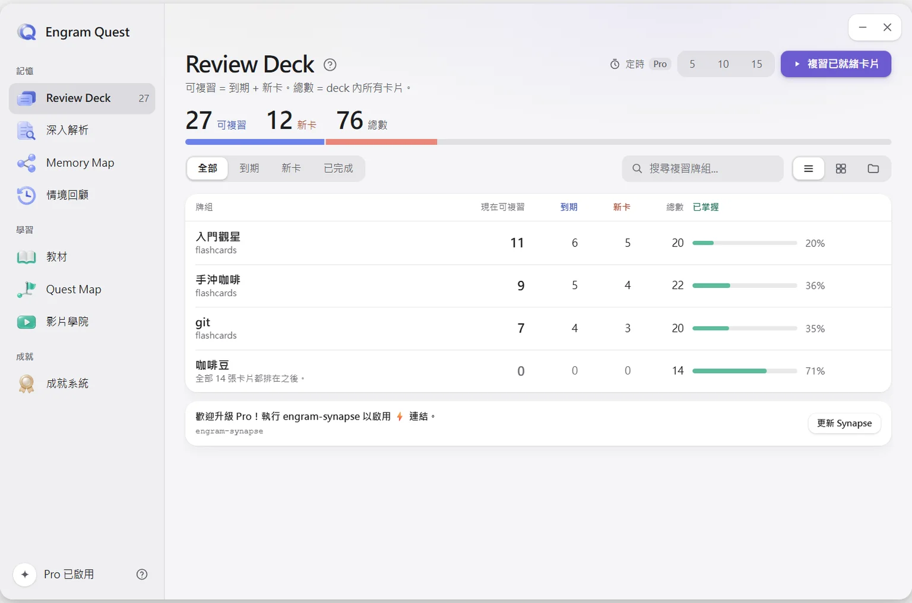

一套建立真實記憶（而非單純「眼熟」）的三階回想系統：

| 階段 | 做什麼 | 其他工具有嗎 |
|---|---|---|
| **L1 主動回想** | 只給問題，強迫大腦在任何提示前先自行搜索 | ✅ 多數閃卡 |
| **L2 脈絡錨點** ⭐ | AI 搜尋*你的* vault，重建你第一次學這個概念的場景 | ❌ **只有這裡有** |
| **L3 收斂提示** | 最後手段，給關鍵字方向，不給答案本身 | 少數有 |

- **FSRS-5 排程** — 間隔依你的實際回想表現調整，不是固定倍數
- **AI 卡片獨立存放** — 生成的卡片放在 `engram-review/`，AI 永遠不動你的來源筆記
- **5 種可混用格式** — 貼整段 AI 回答、多行 Q&A、克漏字、單行卡，同一筆記自由混用
- **編輯寫回** — 複習中改卡片，修改直接存回來源筆記
- **自動偵測** — 任何打上 `#flashcards/主題` 的筆記都會自動收錄

**📺 影片：** <a href="https://youtu.be/XC0NsPVfcwE"></a> <a href="https://youtu.be/pMf5mfCswBo"></a>

▶️ [自己手動建立 Review Deck](https://youtu.be/XC0NsPVfcwE) · ▶️ [貼上 AI 回答快速建卡](https://youtu.be/pMf5mfCswBo)

### 🗺️ Quest Map — 應用任務地圖

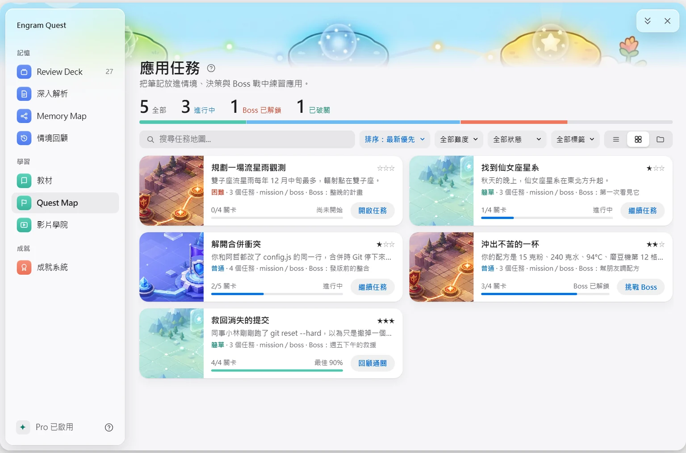

把筆記、主題或教材課程變成練習地圖，看你能不能真的**用上**學到的東西。每個任務把你放進沒看過的情境，真實的資料就在眼前，要你做出懂這件事的人會做的判斷，然後計分。

- **一個任務地圖一個資料夾** — 一張地圖，每個任務一頁獨立的互動頁面，存在 `engram-quest/quests/`，從 Quest Map 頁打開
- **難度分級** — Easy / Medium / Hard，跟 AI 要你需要的程度
- **Boss Battle** — 章末的整合案例，測判斷、排序、取捨或診斷能力
- **進度安全** — 分數和完成度存在 `engram-quest/state/`，和任務本身分開，AI 更新關卡時不會洗掉你的進度
- 以前寫在筆記裡的 `quest-map` 區塊照樣能打開

### 🎓 教材（Lesson Academy）— AI 打造的課程

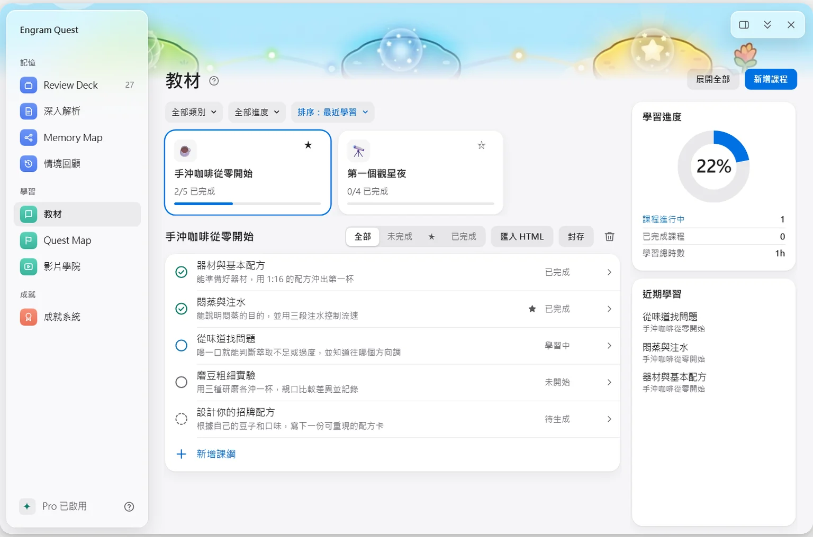

告訴 AI 你想學什麼 — 它建立一整套可在 Obsidian 內研讀的互動式 HTML 課程。

- **目標導向** — skill 會先問你*為什麼*學、現在的程度，所以 .NET 工程師學 React 拿到的課，和設計師學 React 完全不同
- **課綱先行** — 生成前先給你課程大綱確認（改大綱很便宜，重生成課程很貴）
- **讀懂你的 vault** — 指向你既有的筆記，課程就和你已知的知識連在一起
- **網路查證** — 對快速更新的技術主題會查網路並附上來源，而不是瞎猜
- **概念圖課時** — 課程可穿插 Obsidian 原生 Canvas 概念圖（學習地圖、對比、分類），在真正的 Canvas 分頁開啟，可自由拖拉、加註記
- **每堂課以測驗結尾**，形成即時回饋迴圈 — 之後還能把整套課程轉成 Review Deck 卡片或 Quest Map

**📺 影片：** <a href="https://youtu.be/G8HxBl9Hf9o"></a>

▶️ [用 Claude Code 建立課程](https://youtu.be/G8HxBl9Hf9o)

### 🎬 影片學院 — 一句話，做成教學短片

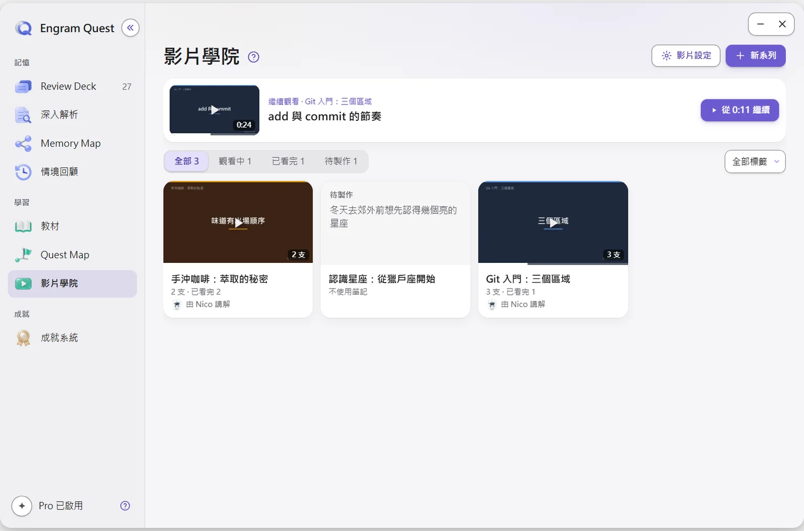

說一句想學或想複習什麼，例如「我的 coding 流程」「SEO」，AI 就把它做成教學短片，長度依要教的內容決定。

- **說目標就好** — 例如「架設網站」「學會函數」，想補充再補充。要用哪些筆記、是教學還是複習、拆成幾支，都由 AI 判斷（也可以拖入筆記指定範圍，或選「不使用筆記」）
- **書架 → 播放器** — 系列以卡片呈現（可篩選觀看中／未開始／已看完／待生成、依 AI 分好的標籤如「軟體」篩選，系列多了可搜尋），點進去邊看邊切換播放清單；看到哪裡都會記住，下次從上次的位置續播
- **選你的老師** — 每位老師教法不同，可以先看、先聽。Nico 免費；其他老師和替單一系列指定老師需要 Pro。還在待製作的系列可以編輯
- **設一次就好** — 老師、畫質（高畫質 1080p，省空間 720p）、旁白語言、配音引擎、字幕、複習卡都在「影片設定」。畫面都在 Engram 攝影棚，AI 依內容選明棚或暗棚
- 影片存在 vault 的 `engram-quest/videos/`。桌面版可按「標記已看完」旁的資料夾按鈕，直接在系統檔案總管中找到影片檔。想在手機上看，同步工具也要同步這裡的 mp4，不要排除（用 git 的話，每支影片都會留在 git 歷史裡，這個取捨由你決定）

> 影片用 **Claude Code** 製作：在 `設定 → EngramQuest → AI Skills` 安裝 **Animated Course** skill，在影片學院按 **新系列** 寫下想學什麼，再請 Claude Code 製作。

### 🧠 Memory Map — 看見全局

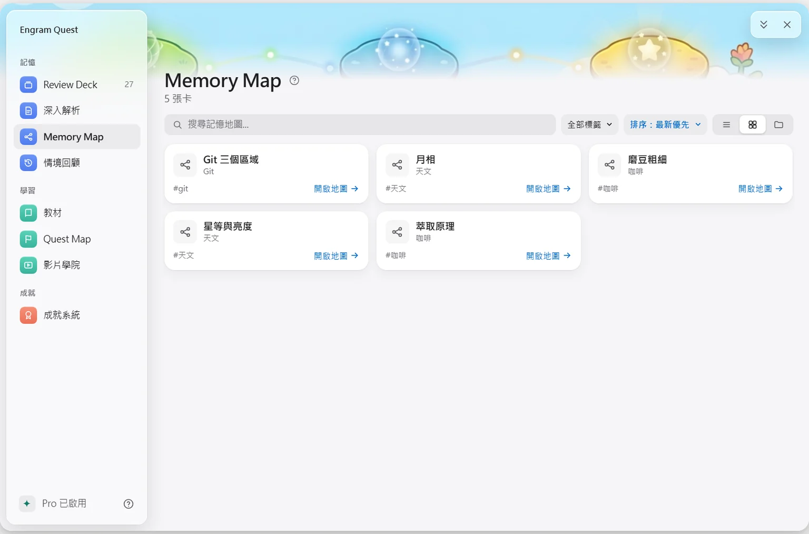

用 Obsidian Canvas 視覺化抽象概念。

- AI 用記憶科學生成視覺知識圖 — 反直覺（novelty）、連結你既有筆記（association）、分組（chunking）、類比（elaboration）
- 任何命名為 `{筆記名}-memory.canvas` 的檔案會在 Hub → Memory Map 自動偵測
- 複習途中，Memory Map 按鈕會自動找到並打開對應的 canvas

### 🎞️ 情境回顧 — 回到讀過的東西

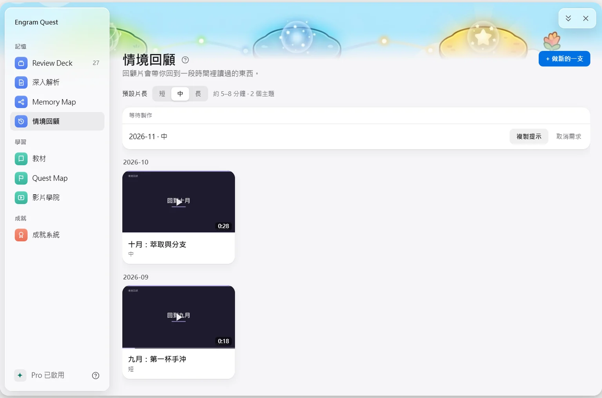

情境回顧片帶你回到一個月（或連續幾個月）讀過的東西，讓概念在你當初遇到它的情境裡回來。每個主題都會先有一份**回想包**——一句話總覽，加上放進 Review Deck 的回想題——值得的主題才做成影片。

- **觀看免費** — 回顧片依期間分組，新的在上面，點開就播放
- **製作新片（Pro）** — 按 **+ 做新的一支**，選期間和長度（短、中、長，可設定預設長度），請求會出現在「等待製作」。複製它的提示詞貼到 Claude Code，由 **Episodic Review** skill 做成影片；請求隨時可以取消
- 回顧片存在 `engram-quest/videos/episodic-recall/`

### 🏆 成就系統

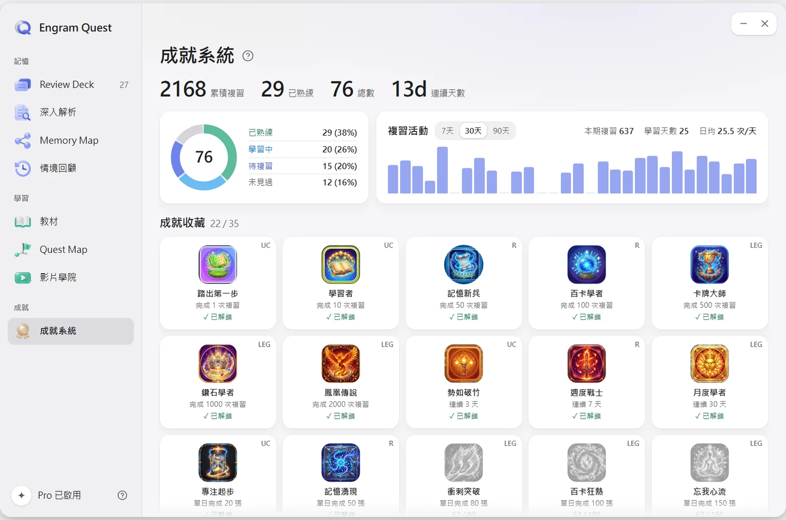

用 3D 渲染圖示與稀有度分級追蹤你的學習里程碑 — 從複習次數、連續天數、精熟卡片，到教材完課與 Quest Map 進度。這一頁顯示你的總數、卡片熟悉度，以及最近 7、30 或 90 天的活動。點任一成就查看它的說明與進度。

### 📖 深入解析 — 難卡的白話救援（Pro）

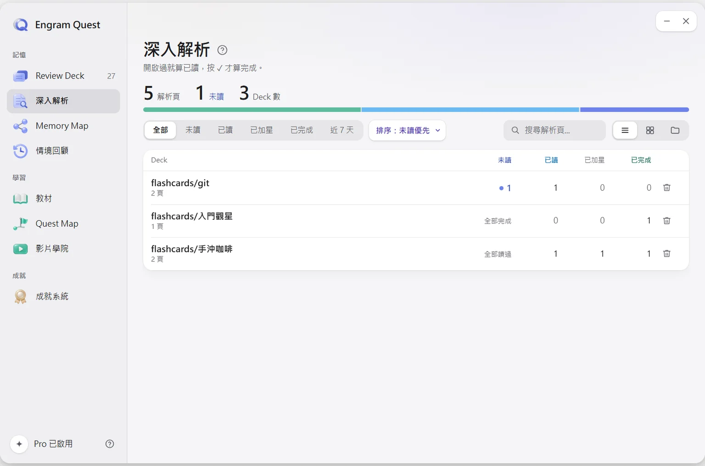

複習時遇到看不懂的卡，按「**加入解析佇列**」標記它。AI 會診斷這張卡為什麼難（內容太難？描述太簡略？缺乏脈絡？），生成一頁自包含的圖解深入解析——先講它解決什麼問題，再給宏觀地圖、記憶錨比喻、逐層拆解與常見混淆，最後回到你原本的卡片。解析頁**沒有自己的排程**：原卡照常複習，若持續答錯，解析會自動用更淺的切入點重寫。也可以直接說 — *「幫我做一份資料飛輪的深入解析。」* 同一個 skill 也做**洞見**頁：指定一個主題、一門課或一個資料夾的筆記，它會整理出這些內容怎麼連在一起、可以推出什麼。啟用 Pro 後，深入解析會出現在記憶分組。進度條把解析頁分成**已完成、已讀、未讀**；點開就算已讀，只有你自己按 ✓ 才算完成。值得再看的可以加星。

---

## 🚀 決定要用了？安裝後的第一分鐘

1. **安裝插件** — 在 Community Plugins 搜尋 **EngramQuest**（或[在 Obsidian 中開啟](obsidian://show-plugin?id=engram-quest)）。
2. **打開 Hub** — 點左側 ribbon 的 EngramQuest 圖示。
3. **選一條路：**
   - **不用 AI？** 任何筆記打上 `#flashcards/主題` tag，寫一張 `Q:/A:` 卡片，它就立刻出現在你的 Review Deck。→ [自己寫卡片](#-自己寫卡片不需要-ai)
   - **有 AI 工具？** 安裝一次 Skills（`設定 → EngramQuest → AI Skills`），然後直接說：*「用我的數學筆記建一副 review deck。」* → [AI 路徑](#-快速開始ai-路徑)

---

## ✍️ 自己寫卡片（不需要 AI）

打上 `#flashcards/主題` tag，選一種格式。五種格式可在同一筆記自由混用：

| 格式 | 最適合 | 語法 |
|---|---|---|
| 🟢 `Q:/A:` 問答 ⭐ | **推薦的日常格式。** 多行答案、圖片、表格、程式碼 | `Q: 問題` → `A:` — 兩個空行結束卡片 |
| 🔵 `---` 圍欄問答 | 答案內含空行的既有筆記 | 用 `---` 行包住 `Q:/A:` |
| 🟡 `%%card%%` 長答案 | 貼可能含 `---` 分隔線的 AI 輸出 | 用兩行 `%%card%%` 包住一張卡 |
| 🧩 `{{c1::}}` 克漏字 | 填空，與 Anki 相容 | `{{c1::答案}}` 或 `{{c1::答案::提示}}` |
| ⚪ `::` 單行 | 快速單行問答 | `問題 :: 答案` |

<details>
<summary>看卡片格式範例</summary>

```
#flashcards/math

Q: 什麼是導數？
A: 函數在某點的瞬時變化率。
   形式上：lim(h→0) [f(x+h) − f(x)] / h

---
Q: Stripe 的核心模型是什麼？
A: Stripe 本質上是一個 Saga 系統。
   它處理 payment_intent 狀態機、重試/失敗處理、
   以及資金一致性。你只收到結果。
---

%%card%%
Q: 該怎麼解釋 agentic testing？
A:
Agentic testing 檢查一個 AI 系統能否可靠完成任務。
---
這個分隔線會留在答案裡面。
%%card%%

{{c1::微積分}} 建立在極限、導數、積分之上。

畢氏定理 :: a² + b² = c²
```

> **小技巧：** 在空行按 `Ctrl+/`（或 `Cmd+/`），Obsidian 會插入 `%% %%` 並把游標放中間。打 `card` 就立刻得到 `%%card%%`。

</details>

---

## 🔬 為什麼有效

EngramQuest 建立在認知科學的四根支柱上：

| 原理 | 對應功能 |
|---|---|
| 間隔複習 | FSRS 在快遺忘的瞬間安排複習 |
| 提取練習 | L1 在任何提示前強制主動回想 |
| 脈絡錨定 | L2 把每張卡錨定到 vault 既有的知識 |
| 精緻化編碼 | Memory Map 為抽象概念建立視覺結構 |

---

## ❓ 常見問題

**Q：一定要用 AI 嗎？**
不用 — 很多使用者都不用。用 `Q:/A:`、`::` 或 `{{c1::}}` 寫卡片，打上 `#flashcards/主題` tag，插件就會自動收錄。

**Q：我的進度存在哪？**
排程資料以 JSON 存在 vault 的 `engram-review/sr/`。AI 生成的卡片在 `engram-review/ai-cards/`。兩者都不碰你的來源筆記。

**Q：EngramQuest 支援 Anki 嗎？**
部分支援。`::` 和 `{{c1::}}` 格式與 Anki 相容 — 搭配 **Obsidian_to_Anki** 社群插件使用。`Q:/A:` 是 EngramQuest 原生格式（豐富的多行答案），不同步到 Anki。

**Q：怎麼讓 AI 建卡時永遠遵守某個模式？**
在筆記用 `==highlight==` 或 `**bold**` 標記關鍵答案，然後在 AI 設定檔（`CLAUDE.md`、`GEMINI.md` 或 `AGENTS.md`）加一條規則：
> `IMPORTANT: When building a Review Deck, every highlighted ==text== must become a review card.`

---

## Pro：四種學習方式

**US$11.99 一次買斷，後續 Pro 功能更新皆包含。** 不升級，也能繼續正常使用既有免費功能。適用稅額於結帳顯示。

| Pro 功能 | 提供什麼 | 狀態 |
| --- | --- | --- |
| 記憶錨點 · Synapse | 複習時以這張卡為中心，畫出它和你學過內容的關聯：熟卡、筆記、深入解析、教材、影片，每條線都寫著為什麼相關 | 已提供；需先由 skill 建立關聯 |
| 深入解析 | 難卡加入佇列，由 skill 生成白話圖解，再回到 Hub 閱讀 | 已提供 |
| 限時複習 | 選擇 5／10／15 分鐘，優先挑出需要複習的卡片 | 已提供 |
| 更多老師與情境回顧片 | 教法各不相同的老師、替系列指定老師，以及把筆記做成回顧片 | 已提供；影片用 Claude Code 製作 |

影片學院的管理、Nico，以及觀看任何影片（包括已經做好的回顧片）都維持免費。從 **Hub 側欄底部的 Pro**（手機上是記憶首頁的 Pro 列）或 **設定 → EngramQuest → 看看 Pro** 開啟圖解介紹，不會自動彈出；淺色、深色使用獨立圖片，跟隨 Obsidian 主題。付款後從 Polar 複製 key，在設定啟用，再重新開啟 Hub。

**揭露事項。** Pro 是選購的一次性付款（US$11.99，透過 Polar）。插件只在兩件事用到網路：向 Polar 驗證授權（只傳送 key 與組織／Benefit 識別碼，不傳送筆記內容），以及安裝影片 skill 時從本專案的 GitHub Releases 下載影片素材。key 與成功快取存於 plugin data.json；成功驗證後最多有 14 天離線緩衝，更新後重新連線驗證。移除本機授權保留學習資料。安裝 skill 會寫入 vault 的 `.claude/skills/`（以及其他 AI 工具對應的資料夾）。目前開發版本使用 sandbox，只接受測試 key。

---

## ☕ 支持

如果 EngramQuest 對你有幫助，歡迎支持它的開發：

[](https://ko-fi.com/wen_aidev)

---

<div align="center">

*Built for lifelong learners. Made with ❤️*

</div>
